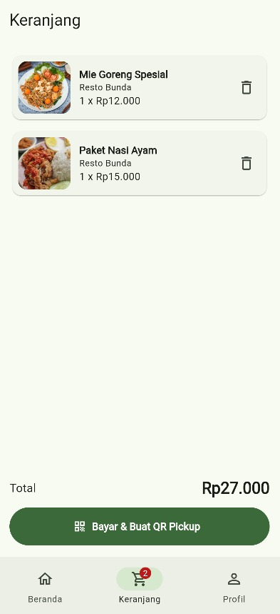
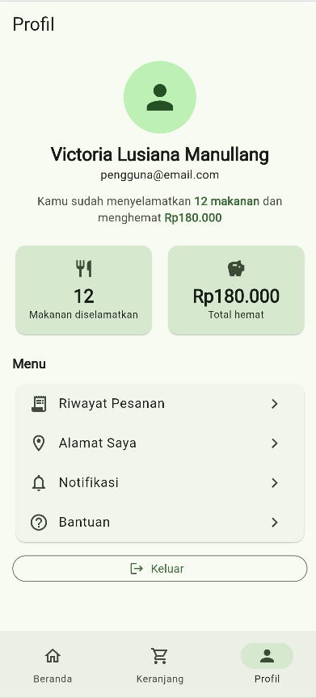

# Save Food 🌱

Aplikasi mobile untuk mengurangi pemborosan makanan dengan menghubungkan bisnis makanan dan konsumen.

**Kelompok:** Daydreamers

| Anggota | NIM |
|---|---|
| Victoria Lusiana Manullang (Ketua) | 241112797 |
| Siska Clarissa | 241112966 |
| Riyanti Teresa | 241112192 |
| Eka Anastasya Situmorang | 241112564 |

**SDGs:** SDG 12 – Responsible Consumption and Production

---

## Progress Pertemuan 1–7

### Kerangka aplikasi (`MainShell`)
- `Scaffold` sebagai kerangka halaman
- `IndexedStack` menjaga state tiap tab saat berpindah
- `NavigationBar` + `NavigationDestination` (Material 3) untuk navigasi bawah
- `Badge` + `ListenableBuilder` menampilkan jumlah item di ikon Keranjang

### 1. Beranda


- `CustomScrollView` + `SliverGrid` untuk grid produk responsif
- `SearchBar`, `ChoiceChip` + `Wrap` untuk pencarian dan filter kategori
- `Card` untuk banner dampak SDG 12 dan kartu produk

### 2. Detail Produk


- `ListView` + `AspectRatio`, `Chip`, `IconButton.outlined`, `Divider`
- `ConstrainedBox` membatasi lebar konten di layar besar

### 3. Keranjang / Checkout


- `ListenableBuilder`, `ListView.separated`, `Card` + `Row`/`Column`

### 4. QR Code / Bukti Pickup


- `QrImageView` (package `qr_flutter`), `Card`, `SingleChildScrollView`

### 5. Profil Pengguna


- `CircleAvatar`, `StatTile` (widget buatan sendiri), `ListTile`, `OutlinedButton`
- `RichText` untuk kalimat ringkasan dengan gaya teks campuran
- `Align` untuk judul bagian "Menu"

---

## Widget Reusable (`lib/widgets/`)

| Widget | Fungsi |
|---|---|
| `ProductCard` | Kartu produk di Beranda |
| `ProductImage` | Gambar dari asset, dengan ikon pengganti jika file tidak ditemukan |
| `PrimaryButton` | Tombol utama berukuran seragam di banyak halaman |
| `InfoRow` | Baris ikon + teks |
| `StatTile` | Kartu statistik kecil di Profil |

## Penerapan Materi

- **Material Design 3:** `useMaterial3: true`, `ColorScheme.fromSeed`, `NavigationBar`
- **Reusable widget:** lihat tabel di atas
- **Asset:** foto produk di `assets/images/`
- **Responsive UI:** `SliverGridDelegateWithMaxCrossAxisExtent` dan `ConstrainedBox(maxWidth)`

## Catatan

- Data produk dan statistik profil masih statis (belum dari server/database).
- Pencarian, Login/Register, dan Riwayat Pesanan dikerjakan pada tahap berikutnya.

## Cara menjalankan

```bash
flutter pub get
flutter run -d chrome
```